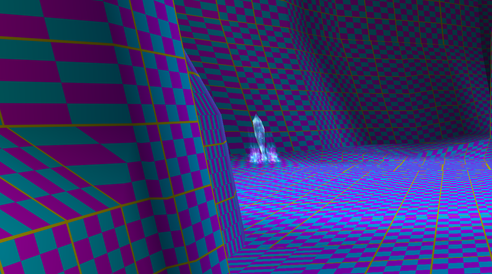

# FFXI Texture Forge

Experimental Final Fantasy XI texture-memory research: an exact-build 1 GiB
asset-pool adapter, Windower diagnostics, and reproducible DAT pressure fixtures.

*Real retail screenshot of the earlier visible 2K checkerboard test, cropped to
remove names and HUD details. This is not an 8K replacement demo.*

## What works today

The adapter enlarges the native asset pool **before it is initialized**. It
checks the supported engine signatures and empty pool slots, then restores both
temporary COM import hooks. It changes process memory; original game DLLs and
ROMs stay untouched. A read-only Lua bridge measures the actual arena and
records pool, process and address-space statistics. The launcher arms only the
new POL child of the Windower process it created.

| Retail fixture payload | Loaded asset-pool use | Remaining pool | Observed result |
| --- | ---: | ---: | --- |
| 768 MiB | About 789–799 MiB | About 225–235 MiB | Short movement and zoning trials |
| 896 MiB | 916.86 MiB | 106.95 MiB | Port → West Sarutabaruta → Port, 60-second return sample |
| 960 MiB | 981.27 MiB | 42.53 MiB | Same route and loaded return sample |

These tests used LAA, dgVoodoo DX11 and a pool of 1 GiB minus 128 bytes. The
fixtures contain additional **unreferenced** texture sections: they establish
native loader/storage pressure, not that every added texture was drawn or was
resident in VRAM. File size, pool usage, private memory and VRAM are different.
The results are short trials, not a general stability guarantee. A local
optional addon/plugin comparison crashed; its cause remains unresolved.

## Development snapshot

This is source and reproducible tooling, not a general-purpose drag-and-drop
patch. It supports one engine build and refuses a mismatch. Renderer-side HD
replacement has passed a narrow **local Ashita/DX11 prototype** test with 16K
diagnostic textures, external storage, and resource clearing. That prototype,
its harness and test assets are not included here, so this public release does
**not** provide renderer-side HD replacement or claim retail Windower/DX12
support. See the [experiment results](docs/renderer-experiment-results.md) and
[remaining renderer work](docs/renderer-roadmap.md).

No game executables, DLLs, DATs, account data, crash dumps, wrapper binaries or
third-party mod assets are distributed. Supply your own installation, existing
Windower and renderer wrapper. See [build and local testing](docs/build.md),
[supported build](docs/supported-build.json), and [third-party boundaries](NOTICE.md).

## Source map

- `native/`: early exact-build adapter, explicit-PID injector, read-only Lua gate,
  guarded pool walker, per-process startup mute and native guard tests.
- `addon/`: locally configured Windower diagnostic template.
- `tools/build.py`: bounded x86 MSVC build, guard tests and optional actual-LuaCore tests.
- `tools/launch_retail_stress.py`: ownership-checked automatic arming.
- `tools/laa.py`: inspect or explicitly apply the LAA header flag with a backup.
- `tools/fixture.py`: build a separate pressure DAT from your own local source.

MIT licensed. FFXI and the pictured game environment belong to their respective
rights holders. This project is not affiliated with Square Enix or Windower.
